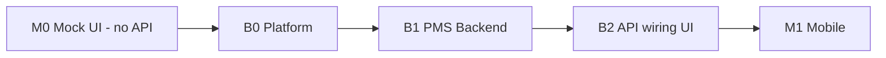

# AyanLab PMS + HOA — Rakip Analizi ve Uygulama Planı

> **For agentic workers:** REQUIRED SUB-SKILL: Use `superpowers:subagent-driven-development` veya `superpowers:executing-plans` ile görev görev ilerle. Tüm işler `- [ ]` checkbox ile takip edilir.

**Goal:** Tek platformda kiralık mülk (Buildium) + site/HOA (Apsiyon TR) yönetimi. **Önce** `ayanlab-pms-ui` mock ekranları (API yok), **sonra** platform + PMS backend, **en son** mobil.

**Architecture:** `ayanlab-pms-backend` (Spring, `ayanlab_pms` DB) domain API’leri; kimlik ve abonelik `ayanlab-platform` üzerinden; dosyalar `ayanlab-vault` ile entegre edilebilir; ödeme/SMS/e-posta `comm` ve harici sağlayıcılar. Kiralık ve HOA aynı org altında **property mode** (`RENTAL` | `ASSOCIATION` | `MIXED`) ile modüler açılır.

**Tech stack:** Java 21, Spring Boot, PostgreSQL, React/Vite (`ayanlab-pms-ui`), Flutter (`ayanlab-pms-mobile`), platform JWT + AuthZ v2 (`db/authz/ipms.json`).

**Referans ekranlar:** Buildium UI PDF (ek: `buildium.pdf`, ~8.9MB, görsel/screenshot ağırlıklı). Mevcut backend zaten Buildium modül haritasına yakın entity/controller setine sahip (`Association`, `Violation`, `ArchitecturalRequest`, `ResidentCenter*`, vb.).

**Mevcut kod durumu (2026-11-18):** Backend geniş CRUD kapsamı var; derleme/authz geçişi tam değil ([`docs/superpowers/plans/2026-11-18-authz-v2-migration.md`](superpowers/plans/2026-11-18-authz-v2-migration.md)). UI yalnızca shell (`ayanlab-pms-ui/src/App.tsx`). Mobil şablon mock.

## Yürütme sırası (zorunlu)

Öncelik kullanıcı kararına göre güncellendi — **önce tam mock UI, sonra backend, en son mobil**.

| Sıra | Faz | Kapsam | API |
|------|-----|--------|-----|
| **1** | **M0** | `ayanlab-pms-ui` tüm modül ekranları | **Yok** — `src/mock/*` + `VITE_MOCK_ONLY=true` |
| **2** | **B0** | `ayanlab-platform` auth, org, billing, authz ipms | Platform API |
| **3** | **B1** | `ayanlab-pms-backend` derleme, domain, DB | `/pms/api` |
| **4** | **B2** | UI → gerçek API; mock kapatılabilir flag | Tam entegrasyon |
| **5** | **M1** | `ayanlab-pms-mobile` portal ekranları | Son aşama |

Mock UI kuralı: `ayanlab-pms-ui` içinde **HTTP çağrısı yok** (axios/fetch yasak prod path’te); sadece `mockApi.ts` / in-memory `mockDb.ts`. Auth ekranı yerel sahte oturum. HRM UI’daki [`ayanlab-hrm-ui/src/mock/`](../ayanlab-hrm/ayanlab-hrm-ui/src/mock/) pattern referans.

---

## Buildium — ürün inceleme (PDF + bilgi mimarisi)

**Kaynaklar:** Kullanıcı PDF’i (**74 sayfa**, tamamı raster/screenshot, OCR metin yok); Buildium resmi menü/özellik ([features](https://www.buildium.com/features/), APM Help dashboard eğitimi).

### Sol menü (Buildium IA)

| Bölüm | Alt ekranlar / işlevler |
|-------|-------------------------|
| **Rentals** | Properties, rent roll, tenant profilleri, rental owner profilleri, outstanding balances |
| **Leasing** | Listings, prospects, applications, leases, lease renewals |
| **Associations** | Association properties, owner/tenant profiles, outstanding balances, **violations**, **architectural requests** |
| **Accounting** | Financials, GL, bank accounts, bills, recurring transactions, **EFT approvals**, budgets, chart of accounts, **company financials** |
| **Maintenance** | Vendors, work orders, inspections (HappyCo entegrasyonu) |
| **Tasks** | Resident/owner talepleri (maintenance + genel) |
| **Communication** | Public site, resident portal ayarı, announcements, email/text, mailing campaigns, automated email templates |
| **Files** | Doküman kütüphanesi |
| **Reports & Analytics Hub** | Income statement, owner statement, balance sheet, analytics (Growth/Premium) |
| **Add-On Services** | Opsiyonel eklentiler |
| **Shortcuts** | Management fees, owner draws, passthrough payments |
| **Marketplace** | Proptech uygulama mağazası |
| **Help & Support** | Academy, ticket, sistem durumu |

### Dashboard widget’ları (Buildium)

| Widget | Mock UI görevi |
|--------|----------------|
| Outstanding balances | M0.3.1 |
| Tasks (açık talepler) | M0.3.2 |
| Maintenance requests (geciken) | M0.3.3 |
| Renters insurance durumu | M0.3.4 |
| Expiring leases | M0.3.5 |
| Listings & applications | M0.3.6 |
| Recent activity | M0.3.7 |
| Violations & association balances | M0.3.8 |
| Bank feed (eşleşmemiş) | M0.3.9 |

### Buildium güçlü / eksik (AyanLab için)

| Güçlü | Plana önceki durum | Ek görev |
|-------|-------------------|----------|
| Uçtan uca SMB rental + association | Kısmen | M0 + B1 |
| Resident Center marka özelleştirme | P4.5 | **M0.20** portal branding mock |
| eSign + screening + pre-lease pay | P5.4 | **B1.15–B1.17**, **M0.11** |
| Shortcuts (fees, draws, passthrough) | Yok | **M0.15**, **B1.18** |
| Marketplace / Add-ons | P5.7 | **M0.21**, **B0.6** |
| Analytics Hub | P5.1 | **M0.22** |
| Unit-level accounting, bank feed | P2, P5.5 | **M0.14**, **B1.12** |
| 24/7 maintenance call center | Harici hizmet | Backlog notu (Comm entegrasyon) |
| HappyCo inspections | Partner | **M0.12** şablon; entegrasyon backlog |

---

## Apsiyon — ürün inceleme (TR site/apartman + HOA benzeri)

**Kaynak:** [apsiyon.com](https://www.apsiyon.com/tum-cozumler), [ürün sayfası](https://www.apsiyon.com/urunler/apsiyon), [aidat](https://www.apsiyon.com/aidat-takip-programi).

| Modül | Apsiyon yeteneği | Buildium karşılığı | Plana önceki durum |
|-------|------------------|--------------------|--------------------|
| Aidat dağılımı (malik/kiracı/kategori) | ● | Association dues / charges | P3.3 |
| Online tahsilat + taksit | ● | Rent collection | P2.13 |
| TR banka entegrasyonu (otomatik eşleşme) | ● | Bank feed | P5.5 |
| Gecikme tazminatı otomatik | ● | Late fees (sınırlı) | **Eksikti → B1.19, M0.16** |
| Sayaç okuma & faturalandırma | ● | Yok (US utilities ayrı) | **Eksikti → B1.20, M0.17** |
| İşletme projesi (plan vs gerçekleşen) | ● | Budget vs actual | P2.6 genişlet |
| İcra takibi | ● | Collections legal yok | **Eksikti → B1.21, M0.18** (TR) |
| ATS 10 haneli borç sorgu kodu | ● | Yok | **Eksikti → B1.22, M0.19** |
| Rezervasyon / konsiyerj | ● | Sınırlı | P3.7 |
| Kargo takibi | ● | Yok | **Eksikti → B1.23, M0.23** |
| Tur kontrol (güvenlik/temizlik) | ● | Yok | **Eksikti → B1.24, M0.24** |
| Geçiş kontrol (plaka, kart, CCTV, HGS) | ● | Yok | **Eksikti → B1.25, M0.25** (entegrasyon) |
| Bakım cihaz kaydı + periyot | ● | Inspections | M0.12 + **B1.26** |
| Personel puantaj / vergi raporu | ● | Yok | **Eksikti → B1.27, M0.26** |
| WhatsApp toplu iletişim | ● | SMS/email | **Eksikti → B0.7, M0.27** |
| Ücretsiz site (anket, forum, galeri) | ● | Public site | P3.13 genişlet **M0.28** |
| Santral / IVR borç bildirimi | ● | Yok | Backlog **B1.28** |
| Fiziksel POS | ● | Online pay | Backlog |
| AVM (alışveriş merkezi) modu | ● (ayrı ürün) | Commercial | Backlog **B1.29** |
| Apsis (küçük site lite) | ● | Yok | **M0.29** org tier UX |
| 3 mobil app (yönetici, sakin, saha) | ● | Resident + field | **M1** ayrı shell’ler |

### Apsiyon eksikleri (AyanLab fırsatı)

- US tarafı: 1099, trust accounting, leasing funnel, HOA architectural (Apsiyon zayıf).
- Kurumsal GL / çok para birimi / open API (Apsiyon sınırlı).
- Birleşik **kiralık ABD PMS + TR site yönetimi** tek UX — rakipte yok.

### Apsiyon satırı — rakip tablosuna eklenti

| Ürün | Güçlü | Eksik | AyanLab |
|------|-------|-------|---------|
| **Apsiyon** | TR aidat, sayaç, banka, icra, geçiş/tur, WhatsApp, 3 mobil | US rental/HOA, derin leasing, 1099 | **TR modül paketi** + Buildium UX |

---

## PDF ekran envanteri (Buildium — 74 sayfa)

Sayfa başına ekran adı OCR ile çıkarılamadı; sprint walkthrough: PDF sırası ↔ menü IA eşlemesi. Önerilen sayfa grupları (tahmini):

| Sayfa aralığı | Beklenen ekran grubu | Mock görev |
|---------------|----------------------|------------|
| 1–8 | Login, dashboard, widget detay | M0.2–M0.3 |
| 9–18 | Rentals (listeler, detay, rent roll) | M0.4 |
| 19–28 | Leasing | M0.5 |
| 29–36 | Associations + violations | M0.6 |
| 37–48 | Accounting | M0.7 |
| 49–54 | Maintenance + vendors | M0.8 |
| 55–58 | Tasks, Communication | M0.9–M0.10 |
| 59–62 | Files, Reports | M0.13–M0.14 |
| 63–66 | Resident portal / public site | M0.20 |
| 67–70 | Settings, shortcuts | M0.15, M0.30 |
| 71–74 | Marketplace, help | M0.21, M0.31 |

---

## Global kısıtlar

- API tabanı: `/pms/api` ([`docs/API-PATHS.md`](API-PATHS.md)); host port **8105** / UI **3105** ([`docs/PORTS.md`](PORTS.md)).
- Personalar: `SITE_MANAGER`, `ORG_ADMIN`, `VENDOR`, `MAINTENANCE_STAFF`, `TENANT`, `HOME_OWNER` ([`apps-catalog.json`](../ayanlab-platform/ayanlab-platform-backend/src/main/resources/db/apps-catalog.json)).
- AuthZ kaynakları: `dashboard`, `properties`, `tenants`, `applicants`, `rental_owners`, `associations`, `violations`, `leasing`, `accounting`, `maintenance`, `vendors`, `work_orders`, `tasks`, `communication`, `files`, `reports`, `analytics`, `addons`, `settings`, `users`, `roles`, `permissions`, `subscriptions`.
- Çok kiracılı org modeli platform ile uyumlu; PII ve ödeme verisi için audit log zorunlu (ileride `vault` + export job’lar).

---

## Ortak özellik sözlüğü (karşılaştırma eksenleri)

| Eksen | Kiralık PMS | HOA / Association |
|-------|-------------|-------------------|
| **Portföy** | Bina, birim, sahip, yönetim anlaşması | Association, lot/unit, owner of record |
| **Sözleşme** | Lease, renewal, deposit, move-in/out | CC&R, deed restrictions, renter guest rules |
| **Gelir** | Kira, late fee, CAM (ticari) | Assessment, special assessment, dues |
| **Gider** | Owner draw, trust accounting | Vendor invoice, reserve / operating fund |
| **İş emri** | Tenant maintenance | Common area / amenity maintenance |
| **Uyumluluk** | Fair housing, lead paint, 1099 | Violation, architectural, board approvals |
| **Portal** | Resident / renter | Homeowner, board member, committee |
| **Ödeme** | Rent collection, ACH/card | HOA dues, autopay, lockbox |
| **Rapor** | Rent roll, delinquency, P&L | AR aging by owner, budget vs actual, reserves |

Aşağıdaki ürün tablolarında **Güçlü** = pazarın bu üründe öne çıkan yetenekler; **Eksik** = tipik müşteri şikayeti, zayıf modül veya AyanLab’ın fırsat alanı.

---

## Kiralık PMS — ürün karşılaştırması

| Ürün | Güçlü yönler (yapabildikleri) | Eksik / zayıf taraflar | AyanLab planına yansıması |
|------|------------------------------|------------------------|---------------------------|
| **AppFolio Property Manager** | AI destekli leasing stack, güçlü resident screening, marketplace entegrasyonları, ölçeklenebilir portföy | Fiyat/karmaşıklık, küçük PM için ağır; derin HOA genelde zayıf | Leasing + screening fazı; marketplace entegrasyonları v2 |
| **Buildium** | SMB odaklı uçtan uca: accounting, leasing, maintenance, owner/tenant portal; net UX | Kurumsal/çok büyük portföyde sınır; uluslararası/çok para birimi zayıf | **Birincil UX referansı** (PDF); modül sırası Buildium ile hizala |
| **Yardi Voyager** | Kurumsal ölçek, commercial + res, derin accounting, BI | Uygulama maliyeti, uzun implementasyon, SMB UX | Enterprise raporlama ve GL derinliği Faz 3+ |
| **Rent Manager** | Esnek özelleştirme, RV/self-storage niş, güçlü API | Öğrenme eğrisi, modern mobil/UX geride kalabilir | API-first ve özelleştirilebilir rapor tanımları |
| **Entrata** | Büyük multifamily, marketing + ops tek platform | Küçük özel PM için overkill; sözleşme süresi | Multifamily marketing modülü opsiyonel |
| **Re-Leased** | Ticari (commercial) lease abstraction, Avustralya/NZ güçlü | US residential + HOA sınırlı | Commercial lease varyantı backlog |
| **RentPost** | Ucuz, basit online rent collection | Sınırlı accounting, maintenance, owner reporting | Ödeme hattı MVP’de sade tutulabilir |
| **PayProp** | Trust accounting, owner payout otomasyonu (özellikle ZA/UK/US) | Tam PMS değil; leasing/maintenance zayıf | Owner disbursement ve trust ledger Faz 2 |
| **DoorLoop** | Modern UX, hızlı onboarding, all-in-one SMB | Yeni ürün: derin rapor/ticari/HOA sınırlı | Hızlı onboarding ve wizard UX hedefi |
| **MRI Residential Management** | Kurumsal residential, entegrasyon ekosistemi | SMB fiyat/UX uygun değil | Entegrasyon hub Faz 4 |
| **Rentec Direct** | Uygun fiyat, landlord odaklı, screening | Ölçek ve çok lokasyonlu org zayıf | Küçük landlord “lite mode” persona |
| **Avail** | Landlord DIY, listing + lease docs | Profesyonel PM workflow, HOA yok | Self-serve landlord funnel opsiyonel |
| **Rentvine** | Yatırımcı/PM hibrit, modern API | HOA/community modülü sınırlı | Investor portal / owner statements |
| **Building Stack** | NYC / kooperatif niş, board + rezidans | Coğrafi niş, genel PMS değil | Co-op opsiyonel backlog |
| **Payquad Solutions** | Ödeme ve resident billing odaklı | Geniş PMS değil | Ödeme sağlayıcı soyutlama katmanı |

---

## HOA / Community Association — ürün karşılaştırması

| Ürün | Güçlü yönler | Eksik / zayıf taraflar | AyanLab planına yansıması |
|------|--------------|------------------------|---------------------------|
| **PayHOA** | Basit dues, ödeme, küçük association UX | Büyük master-planned, derin muhasebe, violation workflow | HOA “lite” onboarding şablonu |
| **Enumerate** | CAM ve orta ölçek association accounting | Kiralık PMS birleşik değil | GL + fund accounting HOA Faz 2 |
| **CINC** | Büyük management company, bank entegrasyonu, ölçek | Pahalı, karmaşık; küçük HOA için ağır | Bank feed import + lockbox Faz 3 |
| **FRONTSTEPS** | Resident experience, amenity, community feed | Back-office accounting bazen harici | Community feed + amenity rezervasyon |
| **Condo Manager** | Kanada condo odaklı, compliance | US genişlemesi / unified rental | Bölgesel tax/compliance config |
| **HOA Simplify** | Düşük maliyet, temel dues | Violation, architectural, board tools zayıf | Fiyat segmenti için modül kısıtlama |
| **Vantaca** | Violation + work order + email merge, scale HOA PM | Kiralık tarafı yok; öğrenme eğrisi | **Violation + architectural** öncelik (backend hazır) |
| **TownSq** | Mobil-first community, duyurular, anket | Derin accounting genelde entegrasyon | Homeowner mobil + duyuru (comm entegrasyonu) |
| **Condo Control** | Violation + paket yönetimi | Full GL zayıf | Violation + correspondence |
| **Smartwebs** | Web + marketing sites for associations | Ops/accounting sınırlı | Public site (`PublicSiteSetting`) genişlet |
| **EasyHOA** | Self-managed HOA, basit ledger | Profesyonel yönetim şirketi workflow | Self-managed org tipi |
| **ONR App** | Board portal, document center | Ödeme/GL çeşitli | Board packet + e-imza backlog |
| **RunHOA** | Dues + iletişim | Enterprise ölçek, entegrasyon | — |
| **Yardi Breeze (Associations)** | Yardi ekosistemi, tanıdık accounting | Ayrı ürün hattı; birleşik rental+HOA tek UX değil | AyanLab farkı: **tek ürün, iki mod** |

---

## Özellik kapsama matrisi (özet)

Legend: ● güçlü ○ orta · zayıf / yok

| Özellik | AppFolio | Buildium | Yardi | DoorLoop | Vantaca | PayHOA | **AyanLab hedefi** |
|---------|:--------:|:--------:|:-----:|:--------:|:-------:|:------:|:------------------:|
| Kiralık lease lifecycle | ● | ● | ● | ● | · | · | ● Faz 1 |
| Trust / fund accounting | ○ | ● | ● | ○ | ○ | ○ | ● Faz 2 |
| Online rent / dues pay | ● | ● | ● | ● | ○ | ● | ● Faz 2 |
| Maintenance + vendor | ● | ● | ● | ● | ● | · | ● Faz 1–2 |
| Leasing + screening | ● | ○ | ○ | ● | · | · | ○ Faz 2 |
| Owner / investor portal | ● | ● | ● | ○ | · | · | ● Faz 2 |
| HOA violations | · | ○ | ○ | · | ● | ○ | ● Faz 1 (API) |
| Architectural requests | · | ○ | ○ | · | ● | · | ● Faz 1 (API) |
| Board / voting | · | · | ○ | · | ○ | ○ | ○ Faz 3 |
| Resident mobile app | ● | ○ | ○ | ● | ● | ○ | ● Faz 3 |
| Open API / entegrasyon | ○ | ○ | ● | ○ | ○ | · | ● Faz 2–4 |
| Çok dil (11 dil platform) | · | · | · | · | · | · | ● **Farklılaştırıcı** |
| TR sayaç / aidat tazminatı | · | · | · | · | · | · | ● (Apsiyon) |
| Sayaç & utilities split (Apsiyon) | · | · | · | · | · | · | ● |
| Bank feed TR otomatik eşleşme | · | ○ | ● | · | · | · | ● |

---

## Buildium PDF — ekran / modül envanteri (referans navigasyon)

PDF metin katmanı yok (screenshot); aşağıdaki modül listesi Buildium tipik bilgi mimarisi + mevcut `ipms` controller’lar ile hizalanmıştır. UI sprint’lerinde PDF sayfa sırası walkthrough olarak kullanılacak.

| Modül (Buildium benzeri) | Backend (mevcut) | UI hedef |
|--------------------------|------------------|----------|
| Dashboard | `DashboardController`, `ActivityEventController`, `AnalyticsSnapshotController` | KPI, görevler, delinquency özeti |
| Rentals — Properties / Units | `PropertyController`, `PropertyUnitController`, `PropertyTypeController` | Liste, detay, birim wizard |
| Rentals — Leases | `LeaseController`, `DraftLeaseController`, `LeaseRenewalController` | Lease editor, renewal pipeline |
| People — Tenants / Owners | `TenantController`, `RentalOwnerController`, `OwnershipAccountController` | CRM benzeri kişi kartları |
| Leasing — Listings / Applicants | `ListingController`, `ApplicantController`, `IncomingRequestController` | İlan + başvuru kanban |
| Associations | `AssociationController` | HOA profil, lot/unit |
| Violations / Architectural | `ViolationController`, `ArchitecturalRequestController` | İhlal workflow, board onayı |
| Accounting | `ChartOfAccountController`, `IpmsTransactionController`, `BillController`, `BankAccountController`, `BudgetController`, `RecurringTransactionController`, `TaxFiling1099Controller`, `EftApprovalController` | GL, bankrec, 1099 |
| Maintenance | `MaintenanceRequestController`, `WorkOrderController`, `VendorController`, `PropertyInspectionController` | WO lifecycle, vendor portal |
| Tasks | `TaskController`, `RecurringTaskController` | Takvim, tekrarlayan |
| Communication | `MessageController`, `AnnouncementController`, `CommunicationEmailController`, `EmailTemplateController`, `TextMessage*`, `MailingController` | Inbox, toplu mail/SMS |
| Files | `StoredFileController` | Vault bridge |
| Reports | `ReportDefinitionController`, `DataExportJobController`, `DataImportJobController` | Rapor kütüphanesi |
| Resident Center | `ResidentCenterUserController`, `ResidentCenterContactController`, `PublicSiteSettingController` | Tenant/owner portal |
| Settings / Admin | `SettingsController`, `OrgSettingController`, `AuthorizationController`, `Subscription*` | Org, roller, faturalama |

---

## Faz planı (yüksek seviye)

| Faz | Süre (tahmin) | Çıktı |
|-----|---------------|-------|
| **M0** | 4–8 hf | Tüm admin + portal ekranları mock (API yok) |
| **B0** | 2–3 hf | Platform auth, org, ipms authz, comm hooks |
| **B1** | 4–6 hf | PMS backend derleme, domain, TR modülleri |
| **B2** | 3–4 hf | UI API bağlantısı, mock flag kapatma |
| **M1** | 4 hf | Flutter yönetici / sakin / saha |
| **P5+** | sürekli | Screening, marketplace, entegrasyonlar |

---

## Uygulama görevleri (tam liste)

### M0 — Mock UI (`ayanlab-pms-ui`, API yok)

**Hedef dizin:** `ayanlab-pms/ayanlab-pms-ui/src/` — HRM ile aynı stack: React Router, Tailwind, `mockDb` + `mockApi`, opsiyonel React Query (sadece mock fetcher’a).

- [x] **M0.1** Bağımlılıklar: `react-router-dom`, `tailwindcss`, `lucide-react`, `clsx`, `zod`, `react-hook-form` (HRM `package.json` ile hizalı)
- [x] **M0.2** `VITE_MOCK_ONLY=true` (default via `src/env.ts` + `.env.example`); `src/api/client.ts` — ağ yok
- [x] **M0.3** `AppShell` + Buildium sol menü; rol switcher + Apsis lite toggle (`ayanlab-pms-ui`)
- [x] **M0.4** Mock auth: `LoginPage` → `mockUsers` (pm/accountant/leasing/owner@demo.ayanlab)
- [x] **M0.5** `mockDb.ts`: 3 property, association, leases, balances, maintenance, violations
- [x] **M0.6** `mockApi.ts` + React Query hooks; dashboard + properties mockApi kullanır

**Dashboard (M0.3.x)**

- [x] **M0.3.1** Outstanding balances tablosu + drill-down (dashboard widget)
- [x] **M0.3.2** Open tasks listesi
- [x] **M0.3.3** Overdue maintenance kartı
- [x] **M0.3.4** Renters insurance compliance listesi
- [x] **M0.3.5** Expiring leases (30/60/90 gün)
- [x] **M0.3.6** Vacant listings + pending applications özet
- [x] **M0.3.7** Recent activity feed (statik mock olaylar)
- [x] **M0.3.8** Association violations + unpaid dues widget
- [x] **M0.3.9** Bank feed unmatched (mock satırlar)

**Rentals (M0.4)**

- [x] **M0.4.1** Properties list (tablo; filtre/kolon paneli sonraki sprint)
- [x] **M0.4.2** Property detail (tabs: units, owners, files, notes)
- [x] **M0.4.3** Property create wizard (`/rentals/properties/new` → mock DB)
- [x] **M0.4.4** Rent roll grid (unit × lease × rent)
- [x] **M0.4.5** Tenants list + tenant detail + iletişim
- [x] **M0.4.6** Rental owners list (+ properties; detail sonraki sprint)
- [x] **M0.4.7** Outstanding balances tablo (bulk actions sonraki sprint)

**Leasing (M0.5)**

- [x] **M0.5.1** Listings list + listing editor (foto placeholder)
- [x] **M0.5.2** Prospects kanban (mock)
- [x] **M0.5.3** Applications list + application detail + screening placeholder
- [x] **M0.5.4** Leases list + lease editor (mock save; deposit satırı sonraki)
- [x] **M0.5.5** Draft leases + lease renewals pipeline
- [x] **M0.5.6** eSign status banner (mock, imza bekliyor)

**Associations / HOA (M0.6)**

- [x] **M0.6.1** Associations list + association profile
- [x] **M0.6.2** Unit/lot owner occupant matrix (malik/kiracı — Apsiyon)
- [x] **M0.6.3** Violations list + violation detail + fine timeline
- [x] **M0.6.4** Architectural requests list + committee approve/deny UI
- [x] **M0.6.5** Assessment / aidat planı editor (kategori dağılımı)

**Accounting (M0.7)**

- [x] **M0.7.1** Chart of accounts ağaç
- [x] **M0.7.2** GL transaction register + mock post form
- [x] **M0.7.3** Bank accounts + Match reconciliation
- [x] **M0.7.4** Bills AP + Pay (mock)
- [x] **M0.7.5** Recurring transactions list
- [x] **M0.7.6** EFT approvals + Approve
- [x] **M0.7.7** Budget vs actual (TRY — işletme projesi)
- [x] **M0.7.8** Company vs property scope toggle (+ `/accounting/company`)

**Maintenance (M0.8)**

- [x] **M0.8.1** Maintenance requests inbox
- [x] **M0.8.2** Work orders board + detail + vendor assign
- [x] **M0.8.3** Vendors CRUD + COI expiry badge
- [x] **M0.8.4** Property inspections (checklist template mock, HappyCo badge)

**Tasks & Communication (M0.9–M0.10)**

- [x] **M0.9.1** Tasks list + recurring tasks
- [x] **M0.10.1** Announcements
- [x] **M0.10.2** Email templates + automated rules (form only)
- [x] **M0.10.3** SMS / Text message log (mock)
- [x] **M0.10.4** Mailing campaign wizard
- [x] **M0.10.5** In-app messages inbox

**Files, Reports, Shortcuts (M0.13–M0.15)**

- [x] **M0.13.1** Files browser (klasör ağacı, upload UI only)
- [x] **M0.14.1** Reports kütüphanesi + parametre form + preview tablo
- [x] **M0.14.2** Analytics Hub landing (placeholder grafikler)
- [x] **M0.15.1** Shortcuts: collect management fee, owner draw, passthrough payment modalları

**Portals & public (M0.20, M0.28)**

- [x] **M0.20.1** Resident Center settings (renk, sayfa görünürlüğü; logo upload sonraki)
- [x] **M0.20.2** Tenant portal preview route (bakiye, WO, lease — mock)
- [x] **M0.20.3** Owner portal preview (statement, violations, architectural link)
- [x] **M0.28.1** Public site CMS-lite (duyuru, anket, galeri, forum — Apsiyon)

**Apsiyon-TR mock ekranları (M0.16–M0.29)**

- [x] **M0.16** Gecikme tazminatı kural editor + örnek hesap tablosu
- [x] **M0.17** Sayaç okuma girişi + tüketim dağıtım önizlemesi
- [x] **M0.18** İcra dosyası listesi + durum timeline (TR)
- [x] **M0.19** ATS borç sorgu kodu + Yenile (10 hane)
- [x] **M0.23** Kargo bekleyen paketler listesi
- [x] **M0.24** Tur kontrol rotaları + checkpoint haritası (mock)
- [x] **M0.25** Geçiş kontrol olay günlüğü (plaka/kart)
- [x] **M0.26** Personel puantaj tablosu
- [x] **M0.27** WhatsApp şablon gönderim UI (mock)
- [x] **M0.29** Apsis lite mode — kısıtlı menü toggle

**Settings, marketplace, help (M0.21, M0.30–M0.31)**

- [x] **M0.21.1** Add-on services + Marketplace app grid (mock kartlar)
- [x] **M0.30.1** Org settings, users, roles (read-only mock matrices)
- [x] **M0.30.2** Subscriptions / billing placeholder
- [x] **M0.31.1** Help hub + Academy link placeholders

**M0 çıkış kriteri:** `npm run build` yeşil; tüm menü maddeleri tıklanabilir; **hiçbir dosyada production API URL yok**; Playwright smoke (opsiyonel) sadece route 200. Demo turu: [`pms-demo-walkthrough.md`](pms-demo-walkthrough.md).

---

### B0 — Platform (`ayanlab-platform`)

- [x] **B0.1** `ipms` uygulama kaydı (`default-data.json` applications) + org'lar `db/authz/ipms.json` `organizations`
- [x] **B0.2** AuthZ v2 PMS kataloğu: `ayanlab-platform-backend/src/main/resources/db/authz/ipms.json` (idempotent `AuthorizationCatalogLoader`)
- [x] **B0.3** PMS UI için gateway/proxy env dokümantasyonu → [`docs/pms-platform-integration.md`](pms-platform-integration.md)
- [x] **B0.4** Org + subscription `ORGANIZATION_AND_USER` (`apps-catalog` / `default-data` + doküman)
- [x] **B0.5** Platform admin: PMS modül izinleri UI — platform-ui **IPMS permissions / IPMS roles**
- [x] **B0.6** Marketplace / addon catalog platform billing bağlantısı — `GET /pms/api/marketplace/billing-bridge`
- [x] **B0.7** Comm: WhatsApp kanalı için org-level config stub — `OrgWhatsappChannelSetting` CRUD

---

### B1 — PMS Backend (`ayanlab-pms-backend`)

- [x] **B1.1** Derleme + test yeşil (`ayanlab-pms/ayanlab-pms-backend`: `mvn test`)
- [x] **B1.2** AuthZ catalog: platform kaynak + `ayanlab-pms-backend/src/main/resources/authz/ipms.json` (sync; publish platform’ta)
- [x] **B1.3** `@RequirePermission` + `IpmsAuthz` testleri (`IpmsAuthzTest`, `IpmsCrudPermissionTest`)
- [x] **B1.4** Seed: `ipms-demo-seed.json` + `IpmsDemoDataLoader` (`IPMS_DEMO_ORG_ID`)
- [x] **B1.5** OpenAPI modül etiketleri — `IpmsOpenApiConfiguration` (5 grup)
- [x] **B1.6** Correlation / `X-Client-*` headers (UI `pmsClient.ts` + mevcut `@ClientHeaders`)
- [x] **B1.12** Unit-level accounting alanları — `PropertyUnit` income/expense/reserve GL codes
- [x] **B1.15** Draft lease + eSign webhook stub — `POST /pms/api/webhooks/esign`
- [x] **B1.16** Applicant screening order stub — `POST /pms/api/webhooks/screening`
- [x] **B1.17** Pre-lease payment intent stub — `POST /pms/api/webhooks/pre-lease-payment`
- [x] **B1.18** Shortcuts endpoints (mgmt fee, owner draw, passthrough) — `/pms/api/shortcuts/*`
- [x] **B1.19** `LatePenaltyRule` — gecikme tazminatı (Apsiyon)
- [x] **B1.20** `MeterReading` + allocation billing (Apsiyon) — entity + list API (allocation billing backlog)
- [x] **B1.21** `EnforcementCase` — icra takibi (TR, read-only export) — CRUD + `timelineJson`
- [x] **B1.22** `DebtInquiryCode` — ATS 10 hane
- [x] **B1.23** `ParcelDelivery` — kargo kayıtları
- [x] **B1.24** `PatrolRoute` + `PatrolCheckpoint` + mobile sync API — CRUD (mobile sync backlog)
- [x] **B1.25** `AccessControlEvent` ingest (webhook) — entity + CRUD (webhook ingest backlog)
- [x] **B1.26** `EquipmentAsset` maintenance registry
- [x] **B1.27** `StaffTimesheet` (personel)
- [x] **B1.28** IVR/santral webhook backlog — `POST /pms/api/webhooks/ivr`
- [x] **B1.29** Commercial / AVM property type extension backlog — `commercial_avm` catalog type

### B2 — UI ↔ API entegrasyonu

- [x] **B2.1** `VITE_MOCK_ONLY=false` iskelet + `pmsClient.ts` (axios) + Vite proxy (modül swap B2.2)
- [x] **B2.2** Modül modül mock → API swap — okuma: properties, dashboard, rent roll, tenants/leases/balances/violations, architectural, TR; yazma/mutasyonlar çoğunlukla mock (`VITE_USE_MOCKS`)
- [x] **B2.3** Platform JWT login gerçek akış (`api/services/auth.ts`, `VITE_MOCK_ONLY=false`)
- [x] **B2.4** E2E: lease → charge → portal (gerçek API) — `POST /pms/api/flows/lease-charge-portal` + unit test

### M1 — Mobile (`ayanlab-pms-mobile`) — mock tamamlandı

- [x] **M1.1** Yönetici app: dashboard + onaylar (**mock** — `pm@demo.ayanlab` ve ilgili roller)
- [x] **M1.2** Sakin/owner app: aidat, WO, duyuru, kargo, ATS (`owner@demo.ayanlab`)
- [x] **M1.3** Saha app: tur kontrol + WO (`field@demo.ayanlab`)
- [x] **M1.4** Mock moddan API moda geçiş — `app_config.dart` + `USE_PMS_API` dart-define

---

### P1 — Rental core (backend domain — B1 ile paralel detay)

> **Baseline:** CRUD controller’lar mevcut; iş kuralları/UI derinliği [`pms-domain-baseline.md`](pms-domain-baseline.md).

- [x] **P1.1** Properties: liste, filtre, create/edit, multi-unit — API + mock UI; filtre polish backlog
- [x] **P1.2** Property units — CRUD + unit GL fields (B1.12); lease link UI backlog
- [x] **P1.3** Tenants — CRUD + mock/API list
- [x] **P1.4** Rental owners — CRUD baseline
- [x] **P1.5** Leases — CRUD + B2.4 activate/charge flow
- [x] **P1.6** Lease renewals — `LeaseRenewal*` CRUD baseline
- [x] **P1.7** Outstanding balances — CRUD + dashboard widget
- [x] **P1.8** Maintenance requests — CRUD baseline
- [x] **P1.9** Work orders — CRUD baseline
- [x] **P1.10** Vendors — CRUD baseline
- [x] **P1.11** Property inspections — CRUD baseline
- [x] **P1.12** Tasks + recurring tasks — CRUD baseline
- [x] **P1.13** Listings + applicants — CRUD baseline
- [x] **P1.14** Incoming requests — CRUD baseline
- [x] **P1.15** Activity feed — `ActivityEvent*` + dashboard

### P2 — Accounting, ödeme, raporlama (kiralık)

> CRUD baseline mevcut; posting otomasyonu ve rapor derinliği backlog.

- [x] **P2.1** Chart of accounts — CRUD baseline
- [x] **P2.2** Transactions: charge, payment, credit, transfer
- [x] **P2.3** Recurring transactions: kira posting otomasyonu
- [x] **P2.4** Bills + vendor AP
- [x] **P2.5** Bank accounts: register görünümü
- [x] **P2.6** Budget: yıllık bütçe vs actual (property)
- [x] **P2.7** EFT approvals workflow
- [x] **P2.8** 1099 / tax filing kayıtları (US)
- [x] **P2.9** Financial records: owner statement üretimi
- [x] **P2.10** Owner disbursement raporu (PayProp / Buildium benzeri)
- [x] **P2.11** Report definitions: rent roll, delinquency, trial balance
- [x] **P2.12** Data export/import job UI
- [x] **P2.13** Ödeme sağlayıcı abstraction (Stripe/ACH stub → prod)
- [x] **P2.14** Renters insurance policy takibi

### P3 — HOA / Association derinleştirme

- [x] **P3.1** Association entity UI: bylaws, fiscal year, fund yapısı
- [x] **P3.2** Owner of record vs occupant (HOME_OWNER persona)
- [x] **P3.3** Assessments: düzenli aidat + special assessment engine
- [x] **P3.4** Violations: create, hearing, fine, lien flag (jurisdiction config)
- [x] **P3.5** Architectural requests: committee review, koşullu onay
- [x] **P3.6** CC&R doküman versiyonlama (vault)
- [x] **P3.7** Amenity booking (FRONTSTEPS/TownSq parity) — `booking` app entegrasyonu veya iç modül
- [x] **P3.8** Community announcements: segmentation (owners vs renters)
- [x] **P3.9** Board packet: agenda + ekler + okundu takibi
- [x] **P3.10** E-voting / proxy (basit anket → tam voting Faz 5)
- [x] **P3.11** Reserve study alanları ve rapor
- [x] **P3.12** Self-managed org tipi: rol seti kısıtları (EasyHOA segmenti)
- [x] **P3.13** Public association website: `PublicSiteSetting` tema + CMS-lite

### P4 — İletişim ve portallar (B1/B2; UI karşılıkları M0.10, M0.20)

- [x] **P4.1** Email templates + automated email settings
- [x] **P4.2** Toplu mailing kampanyaları
- [x] **P4.3** SMS hesapları ve mesaj logları (`comm` bridge)
- [x] **P4.4** In-app messaging: tenant ↔ staff
- [x] **P4.5** Resident center admin: portal kullanıcı daveti
- [x] **P4.6** Tenant portal: bakiye, ödeme, maintenance, lease docs
- [x] **P4.7** Owner portal: statements, violations, architectural submit
- [x] **P4.8** Vendor portal: atanan WO, fatura yükleme
- [x] **P4.9** App notifications push (**M1**’e bağlı)
- [x] **P4.10** 11 dil: portal string’leri ARB/JSON parity (UI i18n M0’da başlar; mobil **M1**)

### P5 — Analitik, abonelik, enterprise

- [x] **P5.1** Dashboard analytics snapshots ve KPI tanımları
- [x] **P5.2** Addon catalog ve org subscription accounts (platform billing ile)
- [x] **P5.3** Field staff presence (mobil konum — opsiyonel gizlilik politikası)
- [x] **P5.4** Screening entegrasyonu (TransUnion/Checkr webhook)
- [x] **P5.5** Bank feed / lockbox import (CINC/Yardi class)
- [x] **P5.6** Public API: API key, rate limit, webhook events
- [x] **P5.7** Marketplace: AppFolio-style partner listesi (başlangıç: dokümantasyon)
- [x] **P5.8** Commercial lease varyantları (Re-Leased class) — `CommercialLeaseTerms`, `/commercial-lease-terms`, mock `leasing/commercial`
- [x] **P5.9** Co-op / NYC özellikleri (Building Stack class) — share registry + board packets CRUD, mock nav
- [x] **P5.10** Performans: büyük portföy liste sayfalama, DB index review

### P6 — Kalite, güvenlik, devops

- [x] **P6.1** Kiracı başına veri izolasyonu integration testleri
- [x] **P6.2** PII maskeleme export’ta
- [x] **P6.3** Audit log: accounting ve violation state değişimleri
- [x] **P6.4** E2E: Playwright kritik path (lease create → charge → portal görünür)
- [x] **P6.5** Load test: 10k unit org senaryosu hedefi
- [x] **P6.6** [`docs/DEPLOY.md`](DEPLOY.md) PMS bölümü güncelle

### Rakip özelliklerinden plana alınan backlog (öncelik sırası)

| Kaynak ürün | Özellik | Görev |
|-------------|---------|-------|
| **Buildium** | Shortcuts, marketplace, analytics hub | M0.15, M0.21–22, B1.18 |
| **Buildium** | Dashboard 9 widget seti | M0.3.1–9 |
| **Apsiyon** | Sayaç, gecikme tazminatı, icra, ATS | M0.16–19, B1.19–22 |
| **Apsiyon** | Tur, geçiş, kargo, WhatsApp | M0.23–27, B1.23–25, B0.7 |
| AppFolio | AI leasing assistant | P5.4+ backlog |
| DoorLoop | 15 dk onboarding wizard | M0.4.3, M1.1 |
| Vantaca | Violation letter merge | M0.6.3, P3.4 |
| PayProp | Owner payment split | M0.15.1, P2.10 |
| TownSq | Mobil community feed | M0.28, M1.2 |
| Yardi | Kurumsal BI export | M0.14.2, P5.1 |
| PayHOA | Ultra-simple HOA signup | M0.29, P3.12 |
| Rent Manager | Custom user-defined fields | P5.6 metadata API |

---

## Dosya / bileşen haritası (ilk sprintler)

| Alan | Backend | UI mock (M0) | UI API (B2) |
|------|---------|--------------|-------------|
| Properties | `Property*Controller` | `src/views/rentals/` | `src/api/services/properties.ts` |
| Leasing | `Lease*`, `Listing*`, `Applicant*` | `src/views/leasing/` | `src/api/services/leasing.ts` |
| Accounting | `ChartOfAccount*`, `IpmsTransaction*`, … | `src/views/accounting/` | `src/api/services/accounting.ts` |
| HOA / TR | `Association*`, `Violation*`, + B1.19–27 | `src/views/associations/`, `src/views/tr/` | `src/api/services/hoa.ts` |
| Portals | `ResidentCenter*`, `PublicSite*` | `src/views/portals/` | B2 |
| Mock core | — | `src/mock/mockDb.ts`, `mockApi.ts` | — |
| Shared layout | — | `src/ui/layout/AppShell.tsx` | `src/router.ts` |

---

## Başarı ölçütleri

**M0 (mock UI):**

1. Buildium menüsündeki tüm üst seviye maddeler route’a sahip.
2. Apsiyon TR ekranları (sayaç, tazminat, icra, ATS) mock veri ile görüntülenir.
3. `grep -r "localhost:8105" ayanlab-pms-ui/src` → **0 sonuç** (API yok).

**MVP (B2 sonrası):**

1. Tek org altında hem **kiralık mülk** hem **association** oluşturulabilir.
2. Lease → aylık charge → tenant portalda bakiye görünür.
3. Violation → owner portal → architectural request.
4. Trust accounting + rent roll export.
5. Platform auth ile `PROPERTY_MANAGER` ve `HOME_OWNER` 403/200 doğru.

---

## Notlar ve riskler

- **PDF referans:** 74 sayfa screenshot; OCR kurulumu sonrası sayfa başlık envanteri genişletilebilir.
- **İnceleme yöntemi:** Buildium IA (web + PDF sayfa grupları); Apsiyon modül listesi (resmi site) — binary RE değil, ürün reverse-engineering.
- **PMS derleme:** Authz migration tamamlanmadan production catalog güncellemesi riskli.
- **Ödeme:** PCI scope minimize; hosted checkout tercih.
- **HOA yasal:** Lien/fine kuralları eyalet bazlı config olarak modellenmeli, hard-code yok.

---

## Revizyon geçmişi

| Tarih | Açıklama |
|-------|----------|
| 2026-11-18 | İlk rakip analizi + faz görev listesi |
| 2026-11-18 | Buildium (74p PDF + IA) ve Apsiyon inceleme; M0→B0→B1→M1 öncelik; mock UI görevleri |
| 2026-11-18 | M0.1–M0.6 + dashboard widget’ları: `ayanlab-pms-ui` mock iskelet, `npm run build` OK |
| 2026-11-18 | M0.4.4–7, M0.5.4, M0.6.3–4, M0.20.1–3 mock ekranları |
| 2026-11-18 | M0.4.2–3, M0.7.1–8, M0.16–19 property/accounting/TR mock |
| 2026-11-18 | B0.5–B0.7, B1.5–B1.18/26/28/29, B2.4, M1.4; domain baseline [`pms-domain-baseline.md`](pms-domain-baseline.md) |
| 2026-11-19 | P5.8/P5.9 commercial + co-op CRUD; authz; mock UI; Playwright E2E; router mock-page hook fix |