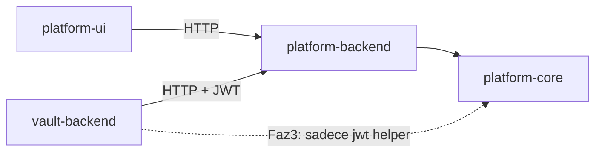

# Platform modül ayrımı — tasarım

**Tarih:** 2026-11-15  
**Durum:** Faz 1–2 tamamlandı (2026-11-15); Faz 3–4 bekliyor

## Hedef

| Modül | Sorumluluk |
|-------|------------|
| `ayanlab-platform/ayanlab-platform-core` | Paylaşılan sözleşmeler: DTO/POJO, servis portları (`I*Service`), güvenlik sözleşmeleri, JWT yardımcıları, enum/constant. **JPA entity, repository, controller yok** (son faz). |
| `ayanlab-platform/ayanlab-platform-backend` | Spring Boot uygulaması: controller, servis implementasyonları, entity, repository, `SecurityConfig`, seed, Flyway/SQL. `platform-core` Maven bağımlılığı. |
| `ayanlab-platform/ayanlab-platform-ui` | Admin / platform CRUD UI (React). |

**Diğer ürünler (vault, crm, …):** Platform’a HTTP; JWT doğrulama için yalnızca ince `platform-core` (veya ileride `platform-client`). Entity/repo import **yok**.

## Mevcut sorunlar (`libs/`)

- `ayanlab-core-domain` içinde controller + service impl + entity + repository birlikte (fat library).
- Ürün backend’leri `ComponentScan` ile kütüphaneyi gömüyor — `SERVICES.md` hedefiyle çelişiyor.
- İki ayrı JAR (`core-domain`, `security`) dağıtım karmaşıklığı.

## Fazlar

### Faz 1 — Konum + tek artifact (bu sprint)

- `libs/*` → `ayanlab-platform/ayanlab-platform-core` (birleşik JAR: `ayanlab-platform-core`).
- `ayanlab-platform/pom.xml` aggregator; `mvn-install-libs` yeni yolu kullanır.
- Eski artifact adları kaldırılır; tüm `pom.xml` güncellenir.
- Davranış değişmez; sadece paketleme ve konum.
- **Cleanup:** kök `libs/` klasörü silindi (2026-11-15).

### Faz 2 — Backend’e taşıma ✅

- `controller` (BaseController hariç), `entity`, `repository`, `service` (tümü), `startup`, `config` (Jwt hariç paylaşılanlar core’da), `annotation` aspect’leri → **backend**
- **Core:** `data` (entity mapper’ları hariç), `condition`, `helper`, `exception`, `provider`, `security` (filter, SecurityConfig, `JwtTokenParser`), `ClientHeaders` + `WebMvcConfig`
- **Backend:** `AuthService`, `JwtService` (token üretimi), persistence, REST
- Ürün `*Application`: `EntityScan` / gömülü core servisler kaldırıldı; scan = `core.config` + `security` + ürün paketi
- `mvn -f ayanlab-platform/pom.xml install -DskipTests` yeşil

### Faz 3 — İnce core + ürün temizliği

- Core POM: JPA/Web/Kafka/GCS yok (mümkün olduğunca).
- `JwtService` parse/validate API core’da; `AuthService` + filter backend’de.
- Ürün `pom.xml`: `ayanlab-platform-core` kaldır; JWT filter veya resource-server config üründe minimal.

### Faz 4 — UI

- Entity listeleri için OpenAPI client / paylaşılan TypeScript tipleri (isteğe bağlı `openapi-generator`).

## Bağımlılık yönü

## Riskler

- Büyük paket taşıması → fazlar ve her fazda `mvn install` + platform `spring-boot:run`.
- Core’da entity bırakmak diğer ürünleri JPA’ya çeker → Faz 2 zorunlu.
- UI “tüm entity CRUD” kapsamı geniş → öncelik auth/RBAC ve core tablolar.

## Başarı kriterleri

- Faz 1: `./ayanlab-platform/run-local.sh` ve Docker build yeşil.
- Faz 2: `ayanlab-platform-core` içinde sıfır `@Entity` ve `@RestController`.
- Faz 3: Vault (ve diğerleri) `EntityScan` olmadan ayağa kalkar.